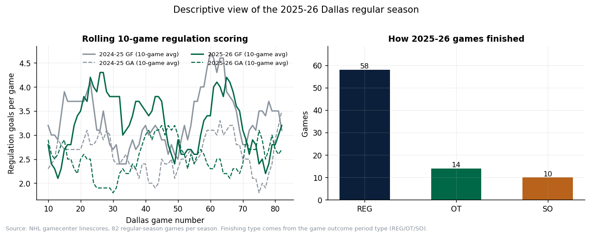

# Dallas Stars 2026-27 Forecasting Project — Data Report

_Generated 2026-10-24 05:11 UTC by `python -m stars_forecast data-report`._

This report describes and validates the observed datasets used to fit the forecast model. It contains **no simulated results**; model outputs are reported separately in `outputs/results-summary.md` and the final academic report.

## 1. What this report covers

| Item                                                   | Value                                                                                            |
| ------------------------------------------------------ | ------------------------------------------------------------------------------------------------ |
| Model-fitting data cutoff                              | End of the 2025-26 regular season                                                                |
| Datasets collected                                     | A-G (team totals, game log, skaters, goalies, 2024-25 season, Central standings, 2026-27 roster) |
| Source files cached under `data/raw/`                | 188                                                                                              |
| Retrieval dates                                        | 2026-10-24                                                                                       |
| Automated data checks                                  | 30/30 passed                                                                                     |
| 2026-27 game results used                              | None (verified by an automated check)                                                            |
| Example checksum (`game_log_dal_2025_26.csv` source) | `fa50c83bf7c0454c6990ff377b5d8533...`                                                          |

## 2. Sources and provenance

Every download is cached unchanged under `data/raw/`, organised by source and season. The manifest `data/raw/source_manifest.json` records the dataset, file, actual source URL, retrieval timestamp, row/file size, SHA-256 checksum and whether the file came from the cache.

| Dataset                                            | Primary source                  | Endpoint / page                                                                                    | Cached file                                              |
| -------------------------------------------------- | ------------------------------- | -------------------------------------------------------------------------------------------------- | -------------------------------------------------------- |
| A — Dallas 2025-26 team totals                    | NHL.com official stats API      | `api.nhle.com/stats/rest/en/team/summary` (seasonId=20252026, gameTypeId=2)                      | `data/raw/nhl/team_summary/team_summary_20252026.json` |
| B — Dallas 2025-26 game log                       | NHL.com official gamecenter API | `api-web.nhle.com/v1/club-schedule-season/DAL/20252026` + `/v1/gamecenter/<gameId>/right-rail` | `data/raw/nhl/schedule/`, `data/raw/nhl/right_rail/` |
| C — Dallas 2025-26 skaters                        | NHL.com official stats API      | `.../skater/summary` (teamAbbrevs="DAL")                                                         | `data/raw/nhl/skaters/`                                |
| D — Dallas 2025-26 goalies                        | NHL.com official stats API      | `.../goalie/summary` (teamAbbrevs="DAL")                                                         | `data/raw/nhl/goalies/`                                |
| E — Dallas 2024-25 totals + game log              | NHL.com official APIs           | same endpoints, seasonId=20242025                                                                  | `data/raw/nhl/...`                                     |
| F — Central Division standings 2021-22 to 2025-26 | NHL.com official standings API  | `api-web.nhle.com/v1/standings/<final regular-season date>`                                      | `data/raw/nhl/standings/`                              |
| G — Initial 2026-27 Dallas roster                 | NHL.com official roster API     | `api-web.nhle.com/v1/roster/DAL/20262027`                                                        | `data/raw/nhl/roster/`                                 |
| Cross-check — Dallas game logs                    | Hockey-Reference                | `hockey-reference.com/teams/DAL/2026_gamelog.html`, `.../2025_gamelog.html`                    | `data/raw/hockey-reference/`                           |

**Substitute-source note.** The proposal named Hockey-Reference as the game-log source. The official NHL gamecenter API was used as the primary game-log source because it carries period-by-period scoring, which is what makes overtime and shootout accounting verifiable. Hockey-Reference was then collected as an independent cross-check, and the cross-check succeeded for both seasons (section 6). This is a source substitution, not a missing cross-check.

The 2026-27 roster announcement page cited in the proposal was also fetched and cached (`data/raw/nhl/news/stars_roster_announcement_2026_27.html`, result recorded in `data/processed/roster_announcement_probe.json`). The roster CSV itself comes from the official roster endpoint, which is a dated snapshot: it is captured on 2026-10-24 and is **not** an opening-night lineup claim.

## 3. Goal conventions (the most important definition in this project)

Three different quantities are routinely called "goals" in hockey data. The datasets keep all three separately, and nothing is silently converted:

| Convention         | Column suffix     | Meaning                                    | 2025-26 Dallas value  |
| ------------------ | ----------------- | ------------------------------------------ | --------------------- |
| Regulation goals   | `_reg`          | goals scored at 60 minutes                 | 267 for / 214 against |
| Final hockey goals | `_final_hockey` | regulation + overtime goals                | 273 for / 222 against |
| Displayed score    | `_displayed`    | final hockey + shootout decision increment | 279 for / 226 against |

The official NHL team totals for 2025-26 are **273 goals for and 222 against**. Those numbers match the *final hockey* convention exactly, and differ from the shootout-inclusive displayed sum by 6 goals. The shootout increment is therefore excluded from the official totals and from the model inputs. This was the reconciliation test that decided the convention, and it is automated (`goal_convention_reconcile_2025_26` in `outputs/qa/data-validation.json`).

Because a tie after 60 minutes is resolved in overtime or a shootout, 14 OT games and 10 SO games are all tied after regulation (24 games in total). Those games are what make the overtime/shootout submodel estimable from observed behaviour rather than from an assumption.

## 4. Dataset A — Dallas 2025-26 team totals

One row, complete (82 games). Canonical file: `data/processed/team_totals_dal_2025_26.csv`. Fields and values:

- Games played: **82**
- Wins: **50**
- Regulation losses: **20**
- Overtime/shootout losses: **12**
- Points: **112**
- Point percentage: **0.6829**
- Goals for: **273**
- Goals against: **222**
- Goals for per game: **3.3293**
- Goals against per game: **2.7073**
- Power-play %: **0.2863**
- Penalty-kill %: **0.8032**
- Shots for per game: **25.2927**
- Shots against per game: **26.1585**
- Faceoff win %: **0.5159**
- Wins in regulation: **38**
- Wins in shootout: **6**
- Team shutouts: **5**

Percentage fields are published as decimals and carry their own numerator and denominator implicitly: the power-play percentage reconciles against the game log's goals-for / opportunities totals in the automated check (71 power-play goals on 248 opportunities reproduces the published 0.2863).

## 5. Dataset B — Dallas 2025-26 game log

82 regular-season rows, one per game, 30 columns. Unique `game_id`, `game_type == 2` for every row, no missing mandatory values, home/away split 41/41.

Fields: game identity and context (`game_id`, `date`, `season`, `opponent`, `home_away`), regulation/OT/SO goals for and against, the three reconciled totals, `result` (W/L), `finish` (REG/OT/SO), shots for/against, power-play goals and opportunities for both teams, faceoff percentage, PIM, hits, blocked shots.

Cleaning performed by code (`collect_game_log`):

1. Keep only `gameType == 2` rows from the season schedule.
2. Read period-by-period scoring from the gamecenter linescore, not the box score score, so regulation goals can be separated from overtime goals.
3. Classify each period as REG, OT or SO and sum per side; the shootout column is kept but never added to a hockey-goal total.
4. Take the finishing type from the game outcome period type and cross-check it against the period arithmetic (an OT game must have exactly one overtime goal).
5. Parse power-play strings of the form "made/opportunities" into integers.

### 5.1 Result and finish distribution

| finish | losses | wins |
| :----- | -----: | ---: |
| OT     |      8 |    6 |
| REG    |     20 |   38 |
| SO     |      4 |    6 |

### 5.2 Descriptive summary of the observed games

| quantity                   | count |   mean |   std | min | 25% |  50% |   75% | max | variance |
| :------------------------- | ----: | -----: | ----: | --: | --: | ---: | ----: | --: | -------: |
| goals_for_reg              |    82 |  3.256 | 1.818 |   0 |   2 |    3 |     4 |   8 |    3.304 |
| goals_against_reg          |    82 |   2.61 | 1.569 |   0 |   1 |  2.5 |  3.75 |   7 |    2.463 |
| goals_for_final_hockey     |    82 |  3.329 | 1.806 |   0 |   2 |    3 |     4 |   8 |    3.261 |
| goals_against_final_hockey |    82 |  2.707 | 1.567 |   0 |   2 |    3 |     4 |   7 |    2.456 |
| shots_for                  |    82 | 25.293 | 5.406 |  15 |  21 |   25 |    28 |  37 |   29.222 |
| shots_against              |    82 | 26.159 | 5.783 |  12 |  22 | 25.5 | 29.75 |  41 |   33.444 |

Artifact: `data/processed/game_log_dal_2025_26.csv`. Per-game raw evidence: 164 cached `right-rail` JSON files.



_Figure: rolling 10-game regulation scoring for both calibration seasons, and how the 82 games finished. Descriptive only — no simulated values appear in this figure._

## 6. Dataset C — Dallas 2025-26 skaters

25 skater rows with Dallas-attributed production. Fields: player id and name, position, team attribution, GP, goals, assists, points, shots, shooting %, power-play goals and points, even-strength goals, overtime goals, game-winning goals, time on ice per game, faceoff % and plus/minus.

**Traded-player handling.** The stats endpoint is queried with a Dallas team filter, so each row is the player's Dallas-only contribution; full-season production for players who arrived from elsewhere is stored separately in `data/processed/arrivals_dal_2026_27_prior_season.csv` (all-team rows). This is the distinction the proposal requires and it is enforced by an automated check (`traded_player_attribution`).

| player            | position | gp | goals | assists | points | shots | shooting_pct | pp_goals | toi_per_gp_min |
| :---------------- | :------- | -: | ----: | ------: | -----: | ----: | -----------: | -------: | -------------: |
| Jason Robertson   | L        | 82 |    45 |      51 |     96 |   294 |      0.15306 |       15 |           20.3 |
| Wyatt Johnston    | C        | 82 |    45 |      41 |     86 |   206 |      0.21844 |       27 |           20.1 |
| Mikko Rantanen    | R        | 64 |    22 |      55 |     77 |   139 |      0.15827 |        6 |           20.2 |
| Miro Heiskanen    | D        | 77 |     9 |      54 |     63 |   148 |      0.06081 |        2 |           25.5 |
| Matt Duchene      | C        | 57 |    16 |      29 |     45 |    89 |      0.17977 |        5 |           16.5 |
| Roope Hintz       | C        | 53 |    15 |      29 |     44 |   126 |      0.11904 |        6 |           17.3 |
| Mavrik Bourque    | C        | 82 |    20 |      21 |     41 |   147 |      0.13605 |        1 |           15.5 |
| Jamie Benn        | L        | 60 |    15 |      21 |     36 |    72 |      0.20833 |        2 |           13.3 |
| Thomas Harley     | D        | 70 |     6 |      30 |     36 |   113 |      0.05309 |        1 |           23.1 |
| Sam Steel         | C        | 73 |    12 |      21 |     33 |    82 |      0.14634 |        1 |           16.1 |
| Esa Lindell       | D        | 82 |     6 |      26 |     32 |    83 |      0.07228 |        1 |           23.2 |
| Justin Hryckowian | C        | 81 |    14 |      16 |     30 |    83 |      0.16867 |        2 |           13.3 |

Skater goals sum to 271 against a team total of 273; the 2 goal difference is accounted for by players who left the roster before the snapshot and did not appear in the team-filtered response. Recorded, not smoothed.

## 7. Dataset D — Dallas 2025-26 goalies

2 goalie rows. Fields: GP, games started, W/L/OTL, shots against, saves, goals against, save %, GAA, shutouts.

| player         | gp | games_started | wins | losses | ot_losses | shots_against | saves | goals_against | save_pct |     gaa | shutouts |
| :------------- | -: | ------------: | ---: | -----: | --------: | ------------: | ----: | ------------: | -------: | ------: | -------: |
| Jake Oettinger | 54 |            54 |   35 |     12 |         6 |          1372 |  1234 |           138 |  0.89941 | 2.59221 |        4 |
| Casey DeSmith  | 30 |            28 |   15 |      8 |         6 |           760 |   689 |            71 |  0.90657 | 2.42735 |        1 |

**Why goalie games and team games are not interchangeable.** Goalie appearances sum to 84 against 82 team games, and goalie goals against sum to 209 against a team total of 222. The gap of 13 goals equals the same-sized gap between goalie shots against (2132) and team shots against (2145): those are empty-net goals, which count against the team but not against a goalie. The automated check requires both gaps to agree, rather than assuming goalie totals must equal team totals.

## 8. Dataset E — Dallas 2024-25 season (backtest calibration only)

Team totals plus an 82-row game log with the same fields and the same conventions as dataset B: `data/processed/team_totals_dal_2024_25.csv`, `data/processed/game_log_dal_2024_25.csv`.

- Official totals: 275 GF, 222 GA, 50-26-6, 106 points
- Game log reproduces those totals: 275 GF / 222 GA, 2W+OTL = 106 points
- Tied after regulation: 15 games (11 OT, 4 SO)

This season is used **only** to fit the frozen backtest model. It is never used to calibrate the 2026-27 forecast.

## 9. Dataset F — Central Division standings, 2021-22 to 2025-26

40 team-season rows = 8 Central teams x 5 seasons. Each row is the standing on that season's final regular-season date (the date is recorded in `as_of_date`). Fields: season, team, games played, W/L/OTL, points, point %, goals for/against, division/conference/league rank, clinch indicator and a derived `made_playoffs` flag.

| season  | team | gp | wins | losses | ot_losses | points | point_pct | goals_for | goals_against | division_rank | made_playoffs |
| :------ | :--- | -: | ---: | -----: | --------: | -----: | --------: | --------: | ------------: | ------------: | :------------ |
| 2025-26 | COL  | 81 |   54 |     16 |        11 |    119 |  0.734568 |       300 |           203 |             1 | True          |
| 2025-26 | DAL  | 82 |   50 |     20 |        12 |    112 |  0.682927 |       279 |           226 |             2 | True          |
| 2025-26 | MIN  | 82 |   46 |     24 |        12 |    104 |  0.634146 |       272 |           240 |             3 | True          |
| 2025-26 | UTA  | 81 |   43 |     32 |         6 |     92 |  0.567901 |       265 |           235 |             4 | True          |
| 2025-26 | NSH  | 81 |   38 |     33 |        10 |     86 |  0.530864 |       243 |           264 |             5 | False         |
| 2025-26 | STL  | 81 |   36 |     33 |        12 |     84 |  0.518519 |       226 |           255 |             6 | False         |
| 2025-26 | WPG  | 81 |   35 |     34 |        12 |     82 |  0.506173 |       230 |           254 |             7 | False         |
| 2025-26 | CHI  | 82 |   29 |     39 |        14 |     72 |  0.439024 |       213 |           275 |             8 | False         |

Point totals for every team-season satisfy `points = 2*W + OTL`; ranks 1-8 are unique within each season. A small number of teams have 81 games played in the recorded standings (postponed games whose final standing was frozen); these rows are recorded as published rather than altered, and the affected seasons are listed in `standings_games_played` in the validation artifact.

Third-place point totals by season (the threshold statistic):

| season  | team | points | point_pct |
| :------ | :--- | -----: | --------: |
| 2021-22 | STL  |    109 |  0.664634 |
| 2022-23 | MIN  |    103 |  0.628049 |
| 2023-24 | COL  |    105 |  0.648148 |
| 2024-25 | COL  |    102 |  0.621951 |
| 2025-26 | MIN  |    104 |  0.634146 |

## 10. Dataset G — Initial 2026-27 Dallas roster (scenario context only)

25 players from the official roster endpoint (snapshot 2026-10-24): 15 forwards, 8 defensemen, 2 goalies. Fields: player id, name, position group and code, sweater number, handedness, height, weight, birth date, snapshot timestamp, source URL.

Arrivals who were not Dallas skaters in 2025-26, with their full-season 2025-26 production (needed for the roster scenarios):

| player         | team_attribution | gp | goals | assists | points | shooting_pct | toi_per_gp_min |
| :------------- | :--------------- | -: | ----: | ------: | -----: | -----------: | -------------: |
| Joel Kiviranta | COL              | 51 |     3 |       6 |      9 |         0.06 |           10.4 |
| David Perron   | OTT,DET          | 65 |    13 |      15 |     28 |      0.13978 |           13.6 |
| Kyle Burroughs | nan              |  0 |     0 |       0 |      0 |          nan |            nan |
| Tyler Myers    | VAN,DAL          | 73 |     1 |      10 |     11 |      0.01136 |           19.5 |

A roster snapshot is not a lineup and not a transaction log. It supports the two personnel scenarios and nothing else; no 2026-27 game result exists in any dataset (checked by `no_2026_27_fitting_data`).

## 11. Reconciliation: observed vs cleaned, and pass/fail evidence

| Quantity                      | Official source | Cleaned game log   | Difference                          | Verdict |
| ----------------------------- | --------------- | ------------------ | ----------------------------------- | ------- |
| 2025-26 goals for             | 273             | 273 (final hockey) | 0                                   | PASS    |
| 2025-26 goals against         | 222             | 222 (final hockey) | 0                                   | PASS    |
| 2025-26 points                | 112             | 112 (2W+OTL)       | 0                                   | PASS    |
| 2025-26 record                | 50-20-12        | 50-20-12           | 0-0-0                               | PASS    |
| 2025-26 games                 | 82              | 82                 | 0                                   | PASS    |
| Shots for (per game x 82)     | 2074            | 2074               | 0                                   | PASS    |
| Shots against (per game x 82) | 2145            | 2145               | 0                                   | PASS    |
| Power-play %                  | 0.2863          | 0.2863             | <0.005                              | PASS    |
| Goalie GA vs team GA          | 222             | 209                | -13 (empty net; matches the SA gap) | PASS    |
| 2024-25 goals for / against   | 275 / 222       | 275 / 222          | 0 / 0                               | PASS    |

### 11.1 Cross-source check against Hockey-Reference

- 2025-26: Hockey-Reference game-log totals **279 GF / 226 GA** over 82 games. These equal our *displayed* sums (279 / 226) exactly. Hockey-Reference prints box-score scores, which include the shootout increment, so the comparison is made against the like-for-like convention rather than against the official NHL total.
- 2024-25: Hockey-Reference 277 GF / 224 GA over 82 games, matching our displayed sums (277 / 224).
- Evidence: `data/processed/hr_crosscheck_2025_26.json`, `data/processed/hr_crosscheck_2024_25.json`; automated check `cross_source_gamelog_reconcile`.

### 11.2 Unresolved or approximate items

- Central Division tables are recorded from a standings snapshot on each season's final date. A handful of clubs show 81 games played; no attempt was made to reconstruct their postponed fixtures, and the point totals are used as published.
- The 2026-27 roster is a snapshot, not an opening-night roster, and no transaction-level arrival/departure dates were collected. Personnel scenarios therefore describe *roster composition*, not a sequence of dated signings.
- No advanced five-on-five, expected-goals or injury datasets were collected. They were optional in the data plan, are not used by the model, and are recorded here as deliberately out of scope rather than missing.

## 12. Data-completeness checklist (A-G)

| Dataset                        | Status                       | Rows   | Artifact                                                                     | Exception / note                                                       |
| ------------------------------ | ---------------------------- | ------ | ---------------------------------------------------------------------------- | ---------------------------------------------------------------------- |
| A — 2025-26 team totals       | Complete                     | 1      | `data/processed/team_totals_dal_2025_26.csv`                               | All listed fields present.                                             |
| B — 2025-26 game log          | Complete                     | 82     | `data/processed/game_log_dal_2025_26.csv`                                  | PP and shots reconciled; advanced 5v5 fields not collected (optional). |
| C — 2025-26 skaters           | Complete (Dallas-attributed) | 25     | `data/processed/skaters_dal_2025_26.csv`                                   | Full-season rows for arrivals stored separately.                       |
| D — 2025-26 goalies           | Complete                     | 2      | `data/processed/goalies_dal_2025_26.csv`                                   | Goalie GA differs from team GA by empty-net goals (documented).        |
| E — 2024-25 totals + game log | Complete                     | 1 + 82 | `data/processed/team_totals_dal_2024_25.csv`, `game_log_dal_2024_25.csv` | Used for the backtest only.                                            |
| F — Central standings 2021-26 | Complete                     | 40     | `data/processed/central_standings_2021_2026.csv`                           | Some clubs at 81 GP as published.                                      |
| G — 2026-27 roster            | Complete (snapshot)          | 25     | `data/processed/roster_dal_2026_27.csv`                                    | Snapshot date recorded; not opening night.                             |

All 30 automated checks pass. The full per-check evidence, including the actual numbers compared, is in `outputs/qa/data-validation.json`.

## 13. Verification of the proposal's quoted 2025-26 figures

The proposal quoted 273 goals for, 222 goals against, a 50-20-12 record and 112 points. These were treated as unverified claims and retrieved independently:

| Claim         | Proposal | Verified (NHL official) | Status  |
| ------------- | -------- | ----------------------- | ------- |
| Goals for     | 273      | 273                     | Matches |
| Goals against | 222      | 222                     | Matches |
| Record        | 50-20-12 | 50-20-12                | Matches |
| Points        | 112      | 112                     | Matches |

The independent verification agrees with the proposal, so no discrepancy needs to be documented for these four values. One *convention* issue does not disappear because the numbers agree: 273/82 and 222/82 include overtime goals, so they are final-hockey rates and not 60-minute regulation rates. The simulation is regulation-based, so it uses the regulation means and both versions are reported side by side in `outputs/tables/diagnostics.json`. 

## 14. Known data limitations

- Goals for and against are not generated by independent processes in reality; game state alters both. The model treats them as independent, and this approximation is documented rather than hidden.
- Game logs do not carry opponent strength, rest days, travel or score situation, so a single constant rate per side cannot separate those effects.
- The tied-game outcome probability rests on one season of tied games, which is a small sample (the count is reported in `outputs/tables/diagnostics.json`).
- Five Central seasons is a small sample for translating points into division outcomes, and historical ties have no recorded tiebreaker.
- Data licensing: the raw NHL and Hockey-Reference responses are cached locally for reproducibility. They are third-party content and should not be redistributed publicly without checking each source's terms; the cache can be regenerated with `python -m stars_forecast collect-data`.

## 15. Reproduction

```bash
python -m stars_forecast collect-data      # cached; safe to re-run
python -m stars_forecast validate-data      # writes outputs/qa/data-validation.json
python -m stars_forecast data-report        # regenerates this document
```
